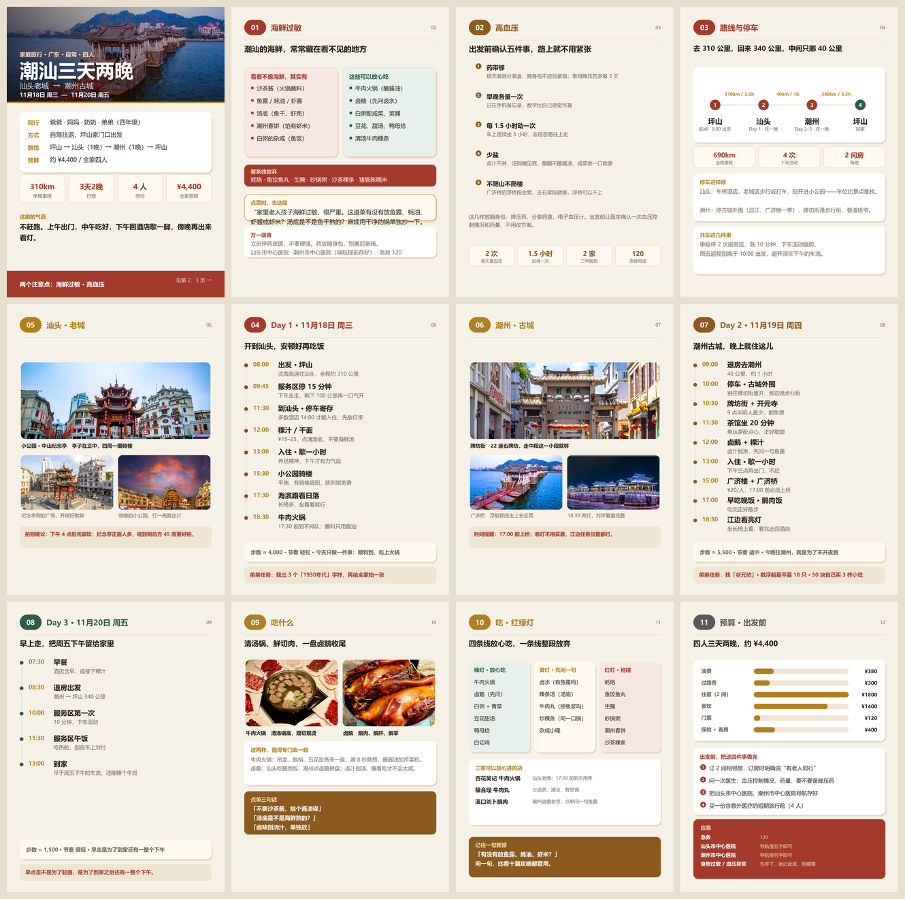

# tripbook

把一份行程 JSON 渲染成一册卡片式 PDF。一页一件事，竖屏看，发到家庭群里点开就能读。

两种起点：

- **已经知道去哪** → 直接排成一册（路线、每天、吃什么、预算、要当心的事）
- **不知道去哪** → 先出一页候选对比，挑定再排册



## 把它当智能体用

仓库里带一份行为规范 `agent/SYSTEM.md`。把它交给任意 coding agent（Claude Code、Codex、DeepSeek Harness 都行），说一句「帮我做份攻略」，接下来是这样：

1. 它先问你缺的条件：几天、从哪走、同行有没有老人孩子
2. 你还没定地方，它给两三个方向做对比，等你挑
3. 挑定之后排出每天的时间表，写成 `trips/*.json`
4. 跑 `python make.py` 出 PDF，自己看一遍再交给你

你不用记命令，也不用写 JSON。

```
你：想带爸妈和上小学的弟弟出去玩几天
它：大概哪几天？从哪出发？
你：11月中，深圳坪山，开车
它：几个人，老人多大年纪、有没有高血压这类要留意的？
…
它：（出一页三个方向的对比）
你：潮汕
它：（出十二页 PDF）
```

没有 agent 也能用：自己照着 `trips/_template.json` 填，一条命令出册。

## 需要什么

- Python 3.9 以上
- Pillow：`pip install pillow`
- 一个中文字体。Windows 用自带的微软雅黑；macOS 和 Linux 换成苹方或思源黑体，或用环境变量指定：

```bash
TRIPBOOK_FONTS=/path/bold.ttc:/path/regular.ttc python make.py trips/chaoshan.json
```

（前一个是粗体，后一个是常规体，中间用冒号隔开。）

## 用

```bash
python make.py trips/chaoshan.json
python make.py trips/chaoshan.json --scale 3 --png
```

输出：

```
out/潮汕三天两晚.pdf    整册
out/pages/*.png         单页（--png）
out/preview.png         缩略图（--png）
```

`--scale` 是渲染倍数，默认 2（2160×2880，约 300dpi）。想要小文件就 `--scale 1`。

## 两个例子

| 文件 | 是什么 | 页数 |
|---|---|---|
| `trips/recommend-guangdong.json` | 不知道去哪时的一页候选对比 | 1 |
| `trips/chaoshan.json` | 挑定之后排成的整册 | 12 |
| `trips/huizhou.json` | 另一册，用来证明它不认城市 | 6 |
| `trips/_template.json` | 空模板，复制成新文件再填 | 3 |

先跑第一个，挑一个，再把挑中的那个排成第二个那样。

**这个仓库不生成行程。** 它把已经写好的行程排成 PDF。目的地、时间点、吃什么、预算，都是写进 `trips/*.json` 的内容：换一个 json 就换一座城，`huizhou.json` 和 `chaoshan.json` 是同一个程序排出来的。行程本身要靠人或者 agent 去问、去查、去排，程序不负责这一步。

仓库里不含照片，`photos/` 目录里只有一张说明。缺图不会报错，会画成写着文件名的中性色块，版式不变（上面那张截图就是这样）。想换成自己的图，看 [photos/README.md](photos/README.md)。

## 写数据

一册书就是 `pages` 数组，按顺序排。

```json
{
  "title": "潮汕三天两晚",
  "output": "潮汕三天两晚.pdf",
  "pages": [
    { "type": "cover", "title": "潮汕三天两晚", "image": "photos/cover.jpg" }
  ]
}
```

页面类型：

| type | 用途 | 主要字段 |
|---|---|---|
| `candidates` | 两到三个目的地并排比 | `candidates` `lead` `strip` |
| `cover` | 封面，整页照片压字 | `image` `title` `sub` `dates` `facts` `stats` `mood` `foot` |
| `compare` | 两栏对照，比如能吃和不能吃 | `left` `right` `strip` `quote` `foot` |
| `rules` | 编号注意事项 | `items` `lead` `foot` `stats` |
| `route` | 路线、停车、开车 | `stops` `stats` `panels` |
| `spread` | 一张大图两张小图 | `hero` `a` `b` 和三行说明 |
| `day` | 一天的时间表 | `rows` `badge` `task` |
| `photos2` | 两张图加一段说明 | `a` `b` `panel` `box` |
| `traffic` | 三栏红绿灯，适合写忌口 | `columns` `shops` `box` |
| `budget` | 预算条、出发前清单、应急 | `items` `todos` `emergency` |

`rows` 每项是 `[时间, 标题, 小字]`；`items` 是 `[正文, 小字]`；`stats` 和 `facts` 是 `[数字, 说明]`。
图片路径相对于 json 文件或仓库根目录都行。

`accent` 可选 `red` `green` `gold` `rust` `grey`，控制那一页的编号块和标题色。

## 设计规则

改版式之前先看一眼，这些是有意为之：

1. 颜色只有纸、墨、灰、四种信号色，全部在 `design/tokens.py` 里，页面文件不出现色值。
2. 一页一件事。放不下就减字或拆页，不缩字号。
3. 每页只有一个强调色，跟着内容走：安全页红，行程页随城市。
4. 不用图标，不用 emoji，不用勾选符号。强调靠颜色和字重。
5. 数字只写能算出来的：里程、步数、人均、预算。
6. 不写「必去」「绝美」「天花板」这类词。

## 已知限制

- 输出是位图 PDF：文字不能选中、不能搜。要可检索的文字版，得走 HTML 排版那条路。
- 页面版式是写在代码里的固定模板，不是自由排版。新增版式要写 Python。
- 不查实时信息。门票、开放时间、车次、天气，自己核对了再写进 JSON。
- 例子里的图片来自公开网络，只适合家庭内部使用。要公开发布，换成自己拍的或带授权的图。

## 目录

```
make.py            页面模板与打印
design/tokens.py   色板与字体
design/canvas.py   画布，坐标按 1080x1440 写，渲染时整体放大
trips/             行程数据，一册一个 json
photos/            图片
docs/              截图
out/               输出，不进仓库
```

## 许可

MIT，见 [LICENSE](LICENSE)。
